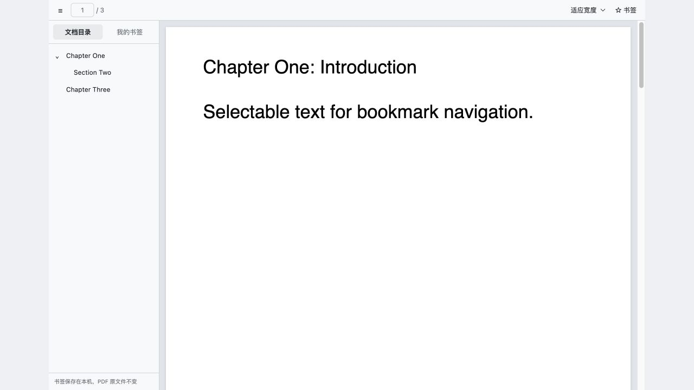
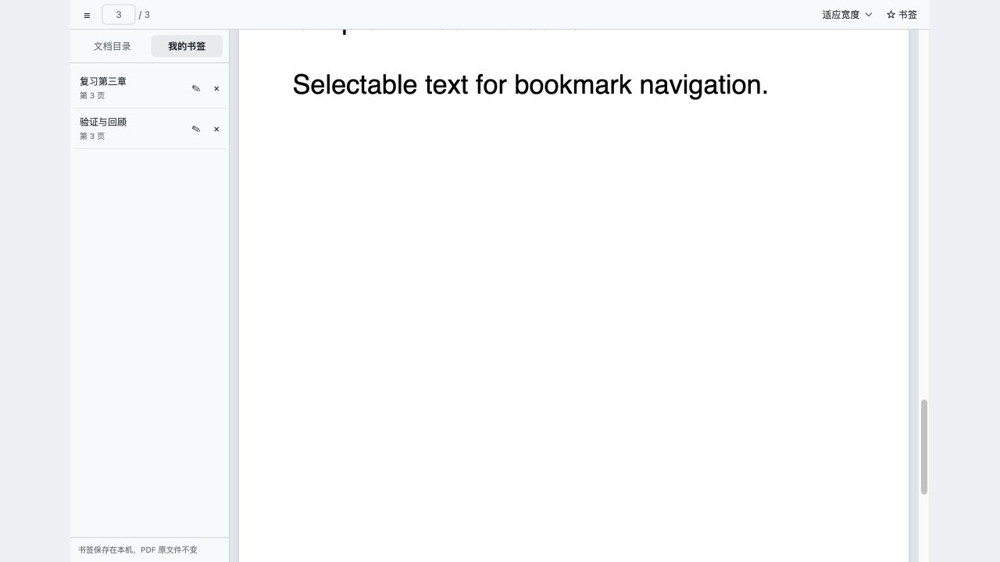

# dsh PDF 书签插件

在 DeepSeek Harness 右侧文件预览中增加 **PDF 书签** 查看器，提供文档目录与本地阅读书签。

## 演示

截图来自 `scripts/harness.mjs` 生成的合成三页 PDF，展示插件组件；不包含真实任务或文件，不代表完整桌面外壳。





## 使用

1. 在现有任务的工作区文件栏打开 PDF。
2. 如果仍是原查看器，在文件头部的查看器菜单选择 **PDF 书签**。
3. 工具栏的 **☰** 开关导航，**文档目录** 展示 PDF 自带章节，可展开层级并点击跳转。
4. 点击 **☆ 书签** 收藏当前阅读位置，可直接输入名称并保存。
5. **我的书签** 支持点击跳转、行内改名和删除。重开同一 PDF、切换任务或重启桌面版后仍可读取。

较窄的侧栏以覆盖面板显示导航，点击目标后自动收起。工具栏提供页码跳转、适应宽度和固定缩放；正文支持连续滚动和文字选取。

没有内置目录的 PDF 显示说明，仍可添加个人书签。需要密码的 PDF 沿用现有引擎的限制，暂不支持输入密码。

## 数据

个人书签只保存文档内容 SHA-256、名称、页码、页内相对位置和创建时间，存在桌面应用自身 origin 的 localStorage 中，键前缀为 `dsh-pdf-bookmarks:v1:`。同一内容的 PDF 副本共用书签；内容变更后使用新的集合。不会修改 PDF，也不会把 PDF 或书签放进模型请求、原有任务记录或账号配置。

已有书签数据损坏、版本不认识或本地存储不可写时，显示错误并保留原数据。卸载插件不清空书签；清除桌面应用的全部网站存储则会移除这些书签。

## 兼容性与故障回退

从 **0.1.2** 起采用能力兼容模式：不声明 `engines.dsh` 或 DSH 相关 peer 版本限制，也不维护宿主版本白名单。升级 dsh 后默认尝试加载，版本号变化本身不会停用插件。启用条件位于 `cordis.patch.yml`：加载入口前，`guard.cjs` 只核对两个构建文件的 SHA-256；文件缺失、损坏或检查异常均仅禁用本插件。客户端在注入前检查 `effect`、`slots.inject/register` 与 `documentPreviews.register`，接口缺失时保留内置查看器；部分注册失败时立即清理自身注册项。

Host 入口 `index.js` 无运行时依赖、不提供或替换任何核心服务。正式插件不安装 `dsh-tools`、Cordis 或其他 dsh 核心包。客户端接口注册异常会被捕获；PDF 引擎在打开 PDF 时才加载，加载失败会移除增强预览定义并交回内置查看器；正文错误边界提供 **使用内置 PDF 预览**。这是对已验证版本及测试故障场景的保护。默认尝试加载不等于承诺所有未来版本兼容；宿主彻底改变模块加载协议或接口语义时仍可能需要适配。

## 安装与停用

0.1.2 在 **macOS Apple Silicon、dsh Desktop 0.2.1-rc.5** 上验证独立 Host 加载与故障隔离；此前 rc.2/rc.3 的验收记录保留在历史更新说明中。其他版本默认尝试加载，但未逐一实测；Web、Windows、Linux 仍未经验证。

当前版本为 **0.1.2**。推荐从 [最新发布页](https://github.com/woody-dx/dsh-pdf-bookmarks/releases/latest) 下载预构建安装包，或直接下载始终指向最新正式版的 [dsh-pdf-bookmarks.tgz](https://github.com/woody-dx/dsh-pdf-bookmarks/releases/latest/download/dsh-pdf-bookmarks.tgz)。在桌面版 **插件 → 添加插件** 中填写下载文件的绝对路径，然后启用插件并完整退出、重新打开 dsh。安装包包含完整 `lib/` 和许可证，不需要构建或运行安装脚本。

从旧版升级时使用同一个插件名称安装新包，不必先卸载或清除应用存储。更新不会迁移、清空个人书签，也不会修改任务或账号。重启后可在插件详情页核对版本 `0.1.2`，再在 PDF 的查看器菜单选择 **PDF 书签**。已有 GitHub 标签、旧安装包和已经下载的文件不会自动变成新版，请下载最新资产后更新。

也可在桌面版 **插件 → 添加插件** 中输入 `dsh-pdf-bookmarks@latest`，从 npm 安装。使用 CLI 时应使用当前桌面版随附的 CLI，执行 `dsh plugin --profile desktop add dsh-pdf-bookmarks@latest --save-exact --ignore-scripts`，随后完整退出并重新打开应用。npm 的 `latest` 与 GitHub 最新正式 Release 保持一致。

也可下载仓库默认分支的源码 ZIP 并解压，在桌面版添加插件时填写解压目录的绝对路径。源码仓库同样包含预构建 `lib/`。不要使用旧版全局 `dsh` CLI 管理较新的桌面 profile。

插件遵循 `dsh.bundle` 组合包机制。启动保护从当前 profile 的包解析找到自身，不要求源码位于特定用户名或 `~/.dsh/plugins` 路径。在 **插件 → 已安装插件** 中可启停和卸载；列表未更新时点击 **刷新**。删除本地源码前应先停用并移除安装引用。

停用可在 dsh 插件列表中禁用本插件，或在 profile patch 最后增加：

```yaml
- id: pdf-bookmarks
  disabled: true
```

再次启用前删除这条手工禁用覆盖。停用或使用查看器菜单切回 **PDF** 后，内置查看器继续工作。删除本地源码目录前应先停用并移除 profile 引用。

## 开发与验证

源码、测试和构建脚本随本地目录保留。开发依赖仅用于构建测试，不安装到 dsh profile。

```sh
npm ci --ignore-scripts
npm test
npm run build
node scripts/host-smoke.cjs
```

`vendor/source.json` 记录来自当前应用的离线 PDF 引擎快照、版本和 SHA-256。构建仅调整模块身份、样式归属及自身所需的低层导出。第三方许可证见 `THIRD_PARTY_NOTICES.md` 和原始快照文件头部。修改源码后必须重新构建以更新完整性清单。

`test/harness.jsx` 和 `scripts/harness.mjs` 是隔离的浏览器验收入口，使用合成三页 PDF，不读取个人任务。`scripts/host-smoke.cjs` 使用独立数据目录验证普通安装、本地链接、未来版本号、引擎缺失、构建损坏和保护脚本异常等场景；需要本机安装上述 dsh Desktop，脚本不会读取真实 profile。

## 与其他插件的区别

本插件只增强已有工作区 PDF 的右侧预览，提供内嵌目录与个人阅读书签。论文文献库、AI 伴读、PDF 内容提取与批注工作台解决其他需求；本插件不增加模型工具或会话持久状态。社区目录中的会话书签与文件路径收藏也不等同于 PDF 页内阅读位置。

## 0.1.2 更新说明

- 取消 `engines.dsh` 与精确版本白名单，改为按实际接口尝试启用。DSH 版本更新不再自动停用插件。
- 保留产物 SHA-256 检查、Host 空入口、客户端异常隔离和引擎失败回退；注册中途失败立即清理已注册的查看器。
- PDF 引擎与 0.1.1 逐字节相同；书签格式、存储键、摘要算法和 PDF 内容均不变。
- 18 项 Node 测试通过，覆盖能力缺失、注册失败清理和旧书签恢复；rc.5 独立 Host 的 8 个正常与故障场景通过，其中未来版本号不再拒绝注册。未来版本号场景只验证版本策略，不代表实测未来宿主接口。
- 未使用真实任务执行 PDF 页面验收；页面上的目录、书签、缩放与引擎故障场景仍需结合实际使用检查。

## 0.1.1 更新说明

- 在原有精确版本白名单中增加经验证的 dsh Desktop `0.2.1-rc.3`，保留 `0.2.1-rc.2`。
- PDF 阅读器和 PDF 引擎的构建文件与 `0.1.0` 逐字节相同；未修改书签格式、存储键和文档内容摘要算法。
- 增加新版启用、未知版本拒绝和旧版书签只读恢复回归测试。15 项 Node 测试通过；在 rc.3 的独立 Host 中验证 8 个正常与故障场景，均正常启动；缺失或损坏产物、保护脚本缺失或抛错时插件不注册。
- 在 rc.3 实机确认已有 PDF 的目录跳转；合成 PDF 验证书签保存、刷新恢复、无目录状态和引擎失败回退。未重新在 rc.2 实机执行整套验收，其既有实现与支持范围保留。

发布者在每个正式 GitHub Release 同时提供带版本号的安装包、固定名称 `dsh-pdf-bookmarks.tgz` 以及 SHA-256 校验文件。社区目录的 `tarball` 使用固定名称的 latest 下载地址；后续发版无需修改该下载地址。

## 发布流程

1. 修改源码后执行 `npm run build`、`npm test` 和 `node scripts/host-smoke.cjs`；Host 验证需要本机 DSH Desktop。
2. 同步更新 `package.json`、`package-lock.json` 与本文版本说明，打包到 `dist/`，更新带版本号的包、固定名称包和对应 SHA-256 文件。
3. 创建对应 `v版本号` 标签，将提交与标签一起推送；随后在 GitHub 创建正式 Release，上传带版本号的安装包、固定名称 `dsh-pdf-bookmarks.tgz` 及两份 SHA-256 文件，将其设为 latest。先核对标签、包版本和校验值，再发布；已有历史 Release 保留。
4. 使用 npm 官方仓库登录，执行 `npm publish ./dist/dsh-pdf-bookmarks-版本号.tgz --access public --tag latest --registry=https://registry.npmjs.org --ignore-scripts`，按 npm 账户要求完成二次验证。
5. 核对 npm latest、GitHub latest 和 Release 资产校验值一致，再更新本机插件。仅修改源码不会自动升级已安装的旧插件。
